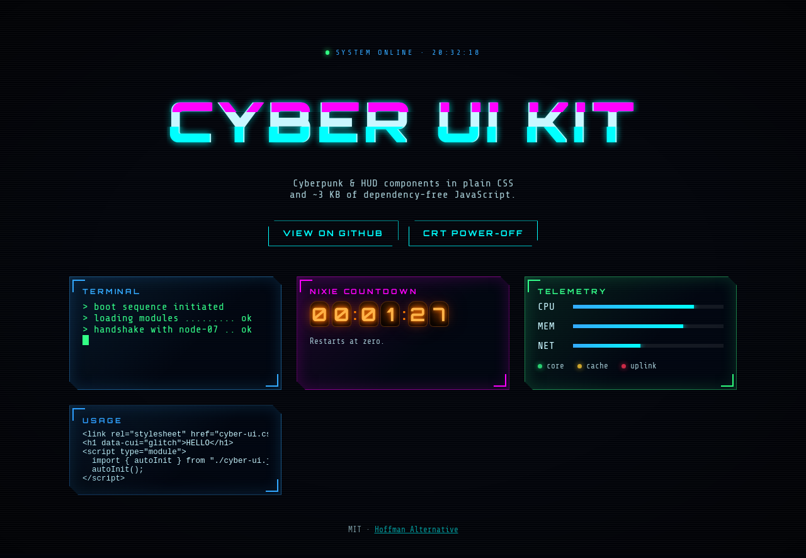

# cyber-ui-kit

[](https://github.com/HOFFMAN-ALTERNATIVE/cyber-ui-kit/actions/workflows/ci.yml)


Cyberpunk and HUD UI components as one CSS file and one ES module with no runtime
dependencies: glitch titles, CRT power-off, nixie countdowns, HUD panels, scanlines,
terminal typing, meters and status lights. The JavaScript is 2.2 kB gzip as shipped
(1.6 kB minified), the CSS another 2.2 kB. It works with static HTML or inside React,
Vue or Svelte because it only touches classes, attributes and text.

**Live demo: https://hoffman-alternative.github.io/cyber-ui-kit/**



## Components

| Component | CSS | JS |
|---|---|---|
| Glitch title | `.cui-glitch[data-text]` | `glitch(el, { burstEvery })` returns `stop()` |
| Scanlines and vignette | `.cui-scanlines` | none |
| HUD panel | `.cui-panel`, `--accent`, `--ok`, `--danger` | none |
| Terminal typing | `.cui-terminal` | `await typewriter(el, lines, { speed, signal })` |
| Nixie countdown | `.cui-nixie` | `nixieCountdown(el, date, { onDone })` returns `stop()` |
| CRT power-off / on | `.cui-crt-off`, `.cui-crt-on` | `await crtOff(el)`, `crtOn(el)` |
| HUD clock | none | `hudClock(el, { timeZone })` returns `stop()` |
| Meter, status dot | `.cui-meter > i`, `.cui-dot` | `setMeter(el, 0..100)` |
| Button | `.cui-btn` | none |

Timers and meters set `role="timer"` / `role="meter"` with ARIA values.
`prefers-reduced-motion` turns off the animations in CSS and makes typing instant in JS.

## Quick start

No build step:

```html
<link rel="stylesheet" href="src/cyber-ui.css">

<body class="cui cui-scanlines">
  <h1 data-cui="glitch">NEON CITY</h1>
  <div data-cui="countdown" data-seconds="300"></div>
  <div data-cui="typewriter" data-lines="> boot|> ready"></div>

  <script type="module">
    import { autoInit } from "./src/cyber-ui.js";
    autoInit();
  </script>
</body>
```

`autoInit()` is idempotent. Call it again after inserting markup; elements that are
already running are skipped.

As a package from git:

```bash
npm i github:HOFFMAN-ALTERNATIVE/cyber-ui-kit
```

```js
import "cyber-ui-kit/css";
import { glitch, crtOff } from "cyber-ui-kit";
```

Fonts: the CSS asks for Share Tech Mono and Orbitron and falls back to system
monospace. Self-host them (the demo uses `@fontsource/share-tech-mono` and
`@fontsource/orbitron`) rather than linking Google Fonts, which sends every visitor's
IP to Google and is a GDPR problem in the EU.

### Theming

```css
:root {
  --cui-glitch: #00ffd5;
  --cui-accent: #ff2bd6;
  --cui-edge: #2f9bff;
  --cui-bg: #05010d;
}
```

## How it works



## Design decisions

- [ADR 0001](docs/adr/0001-plain-css-and-vanilla-js.md): plain CSS plus a vanilla ES
  module instead of framework components. One implementation for every stack; the cost
  is no typed props and no framework-native reactivity.
- [ADR 0002](docs/adr/0002-dom-apis-over-innerhtml.md): build DOM with
  `textContent`/`replaceChildren`, never `innerHTML`. The kit runs under a strict
  Content-Security-Policy and cannot become an XSS sink.
- Every timer-based function returns `stop()`. Frameworks call it on unmount so
  intervals do not leak.

## Limits

- No TypeScript types yet; the JSDoc comments are the API reference.
- The glitch effect uses `::before`/`::after` with `content: attr(data-text)`, so it
  only works on text, not on images or mixed content.
- No SSR helpers. The CSS renders server-side; behaviour starts after `autoInit()`.
- Countdown precision is one second (`setInterval(1000)`), not frame-accurate.

## Security

The library never parses HTML from strings, and the demo build ships a CSP with no
inline scripts and no third-party origins. See [SECURITY.md](SECURITY.md).

```mermaid
flowchart LR
  CSS[cyber-ui.css<br/>tokens · components · keyframes] --> DOM[Your markup]
  JS[cyber-ui.js<br/>ES module, 0 deps] -->|classes / ARIA / timers| DOM
  JS --> AI[autoInit&#40;&#41;<br/>data-cui=*]
  AI --> DOM
  RM[prefers-reduced-motion] -.disables animation.-> CSS
  RM -.instant typing.-> JS
```

## Development

```bash
npm ci
npm run dev     # demo with hot reload
npm test        # Vitest + jsdom, 13 tests
npm run lint
npm run build   # demo -> dist/, deployed to GitHub Pages by CI
```

CI runs `npm audit`, lint, tests and the build, then deploys the demo.

## License

MIT, see [LICENSE](LICENSE).
