# cyber-ui-kit

[](https://github.com/HOFFMAN-ALTERNATIVE/cyber-ui-kit/actions/workflows/ci.yml)


**Cyberpunk / HUD UI components in plain CSS and dependency-free JavaScript.**
Glitch titles, CRT power-off, nixie-tube countdowns, HUD panels, scanlines, terminal typing, meters and status lights.

**▶ Live demo: https://hoffman-alternative.github.io/cyber-ui-kit/**


## Why

Sci-fi interfaces usually come as heavy framework-specific bundles or one-off CodePens.
This kit is a single CSS file + a ~2 KB (gzip) ES module that works with any stack — static HTML, React, Vue, Svelte —
themable through CSS custom properties, accessible (ARIA roles for timers/meters) and respectful of `prefers-reduced-motion`.

## Components

| Component | CSS | JS |
|---|---|---|
| Glitch title | `.cui-glitch[data-text]` | `glitch(el, { burstEvery })` |
| Scanlines + vignette | `.cui-scanlines` | — |
| HUD panel | `.cui-panel`, `--accent`, `--ok`, `--danger` | — |
| Terminal typing | `.cui-terminal` | `await typewriter(el, lines, { speed, signal })` |
| Nixie countdown | `.cui-nixie` | `nixieCountdown(el, date, { onDone })` |
| CRT power-off / on | `.cui-crt-off`, `.cui-crt-on` | `await crtOff(el)`, `crtOn(el)` |
| HUD clock | — | `hudClock(el, { timeZone })` |
| Meter / status dot | `.cui-meter > i`, `.cui-dot` | `setMeter(el, 0..100)` |
| Button | `.cui-btn` | — |

## Quick start

No build step needed:

```html
<link rel="stylesheet" href="https://fonts.googleapis.com/css2?family=Share+Tech+Mono&family=Orbitron:wght@700;900&display=swap">
<link rel="stylesheet" href="src/cyber-ui.css">

<body class="cui cui-scanlines">
  <h1 data-cui="glitch">NEON CITY</h1>
  <div data-cui="countdown" data-seconds="300"></div>
  <div data-cui="typewriter" data-lines="> boot|> ready"></div>

  <script type="module">
    import { autoInit } from "./src/cyber-ui.js";
    autoInit();
  </script>
</body>
```

Or as a package (from git):

```bash
npm i github:HOFFMAN-ALTERNATIVE/cyber-ui-kit
```

```js
import "cyber-ui-kit/css";
import { glitch, crtOff } from "cyber-ui-kit";
```

### Theming

```css
:root {
  --cui-glitch: #00ffd5;
  --cui-accent: #ff2bd6;
  --cui-edge: #2f9bff;
  --cui-bg: #05010d;
}
```

## Architecture

```mermaid
flowchart LR
  CSS[cyber-ui.css<br/>tokens · components · keyframes] --> DOM[Your markup]
  JS[cyber-ui.js<br/>ES module, 0 deps] -->|classes / ARIA / timers| DOM
  JS --> AI[autoInit&#40;&#41;<br/>data-cui=*]
  AI --> DOM
  RM[prefers-reduced-motion] -.disables animation.-> CSS
  RM -.instant typing.-> JS
```



## Development

```bash
npm ci
npm run dev     # demo with hot reload
npm test        # vitest + jsdom
npm run lint    # eslint
npm run build   # demo -> dist/ (deployed to GitHub Pages by CI)
```

## License

MIT — see [LICENSE](LICENSE).
